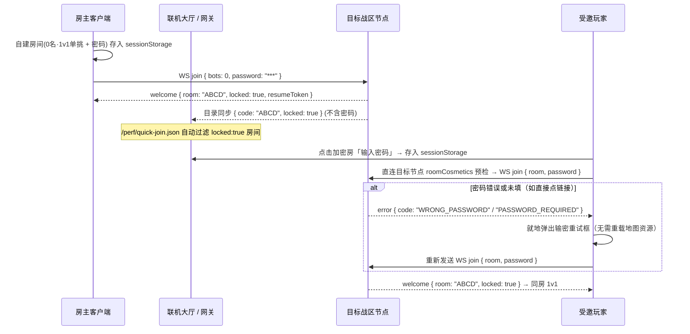

# 系统设计与产品架构手册（DESIGN）

本文档梳理「随时随地CS」各核心子系统的设计目标、数据契约与边界取舍，帮助后续迭代保持风格和架构一致。

---

## 一、核心设计原则

1. **单屏零跳转大厅**：首页 `/perf/`（或 Toy `./index.html`）固定为 `100dvh` 单屏客户端形态，所有外围功能（邮箱、成长福利、探员仓库、装备携带、皮肤库、游戏设置）全部以**按需懒加载弹窗**呈现，不刷新页面，进入战局（`play.html`）后专注 3D 渲染与对战。
2. **克制的 CS2 Panorama 视觉语言**：统一深石板蓝灰基底（`#10191e` / `#152024`）、锐利直角边框、CT 钢蓝（`#85bfd9`）与 T 暖金（`#e3bd6b`）双阵营色、CS2 战术翠绿（`#2d7a57`）用于「人机练习」分流引导；**禁用花哨霓虹渐变与堆砌 Emoji（杜绝 AI 味）**。
3. **零 UGC 合规设计**：适配 B站 Toy 合规规范，不暴露自定义房间名/自由输入简介等高风险 UGC 入口；玩家身份直接读取 Toy SDK 头像与昵称（非 Toy 环境自动降级为本地干员编号）。
4. **高可用与服务器减压优先**：客户端优先静态内置 + CDN 承载素材（游戏服零静态出口），主界面高亮引导纯本地「人机练习」做自然分流，在线集群按节点软/硬上限自动隔离过载。

---

## 二、客户端视觉与渲染体系

### 2.1 双风格 9 图 PBR 烘焙与抗闪烁
- **问题背景**：原始低模纯色地图存在墙体区分度弱、共面贴片 Z-fighting 闪烁、克隆墙体材质后切风格不生效等问题。
- **当前方案**：
  - 9 张地图共享统一 RGBA8 PBR 纹理图集，通过 3 组 `vec4` Uniform 在**影院写实（Cinematic）**与**竞技清透（Competitive）**两档视觉风格间零重编译即时切换（[client/arena-look-presets.js](../../client/arena-look-presets.js)）。
  - 所有 9 张地图均离线修补共面 Z-fighting 碎片，并统一使用 `render/map.mgp` + `compiled/physics.vidx` 紧凑二进制格式以压低体积与加载耗时。
- **武器与匕首**：
  - 22 款近战匕首均配有独立 SVG HUD 剪影；
  - 第三人称武器严格重置 VMDL bind translation 对齐 `wpn` 挂点，杜绝枪模漂移。

### 2.2 大厅零抖动动画架构
- 早期大厅地图背景切换与探员呼吸动画在部分核显/移动端出现 1–2px 抖动与闪白。
- 现行方案（[scripts/maps/mode-ui/screen.css](../../scripts/maps/mode-ui/screen.css)、[screen.js](../../scripts/maps/mode-ui/screen.js)）：
  - 双层 ``（`#backdropA` / `#backdropB`）配合 `img.decode()` 就绪后再 crossfade 切换，切图零闪白；
  - 呼吸动画使用 `translate3d + scale3d + rotate(0.02deg)` 强制走 GPU 合成层避免亚像素抖动；
  - 大厅主干容器配置 `contain: strict` / `isolation: isolate` 隔离重绘。

---

## 三、移动端布局与 2/3/4 指触控体系

核心源码：[client/main.js](../../client/main.js)、[client/touch-controls.js](../../client/touch-controls.js)、[client/touch-layout-editor.js](../../client/touch-layout-editor.js)、[client/mobile-layout.css](../../client/mobile-layout.css)。

1. **零画面拉伸根治**：
   - 历史问题：移动端进入私有九图时被桌面默认 `4:3 stretch` 设置覆盖，导致横屏拉伸 162%、竖屏拉伸 289%。
   - 当前设计：`normalizeVideo` 入口传入 `mobile: mobileDevice() || Boolean(touchControls?.enabled)`，移动端强制按设备真实视口比例渲染（禁用 `4:3` 拉伸选项）；竖屏高宽比下自动做水平 FOV 补偿，避免视野狭窄；监听 `resize`、`visualViewport.resize` 与 `orientationchange` 自动清触控状态并重算画布。
2. **双侧开火与多指操作**：
   - 保留右侧瞄准/开火交互，在左侧移动摇杆上方新增独立**左侧开火键（`fireLeft`）**，方便双指右手拉枪左手点射，以及 3/4 指玩家将开火/开镜/蹲跳排布在屏幕左上/右上角。
3. **可视化按键布局编辑器**：
   - 内置**双指 / 三指 / 四指**三套一键预设，支持逐键拖拽定位、缩放尺寸、调节透明度、显隐开关与 JSON 导入/导出；
   - 在**大厅「游戏设置 → 触屏操作」**（`previewOnly: true`）与**局内设置**双入口打通，布局持久化至 `localStorage`（含 `.backup` 双写防丢）。

---

## 四、成长系统、Toy 云存档与内外红点联动

核心源码：[shared/progression.js](../../shared/progression.js)、[client/toy-cloud-progress.js](../../client/toy-cloud-progress.js)、[client/progression-menu.js](../../client/progression-menu.js)。

### 4.1 资产解锁分层
- **开局基础**：每把枪默认原厂涂装（`*-vanilla`）、基础 CT/T 匕首、基础探员（`ct-sas`、`t-phoenix`）。
- **实战成长梯队**：
  - 枪械皮肤走**单武器专精击杀**（如使用 AK-47 击杀解锁 AK-47 涂装，避免打几局同时弹窗解锁几十把未用过的武器）；
  - 匕首与精英探员走**全局累计击杀 + 完成局数**双条件梯队。
- **B站 Toy 互动礼包（关注 & 一键三连）**：
  - 关注 UP 主礼包（12 件）：`bayonet-vanilla`（刺刀）、`flip-vanilla`（折叠刀）、`ak47-ice-coaled-1143`（可燃冰）、`m4a4-temukau-1228`（反冲精英）等 10 款皮肤/匕首 + 2 名探员；
  - 一键三连礼包（12 件）：`butterfly-vanilla`（蝴蝶刀）、`karambit-vanilla`（爪子刀）、`ak47-vulcan`（火神）、`awp-asiimov`（二西莫夫）等 10 款旗舰皮肤/匕首 + 2 名探员。
  - 领取界面直接渲染包内内置的高清 `.webp` 刀/枪预览图，零外部加载延迟。
- **邮箱/活动直赠覆盖**：`evaluateRequirement()` 优先检查 `progress.grantedSkins` 与 `progress.grantedAgents`，因此通过邮箱直接赠送的任意高阶皮肤/匕首/探员无需达成成长任务即可在皮肤库/探员库直接装备。

### 4.2 云存档与防限流规范
- 云存档键名严格符合 Toy SDK 规则：`cs_prog_v1`（成长、社交解锁、直赠列表、已读/已领邮件、自定义物品）与 `cs_loadout_v1`（已装备皮肤/探员/携带武器）。
- **零高频写入**：绝不在每次击杀写云端；仅在回合结束、对局结束、社交解锁、邮件领取、装备去抖（2.2s）、`pagehide` 时批量提交。
- **单调合并（`mergeProgress`）**：本地与云端合并时，击杀/局数/经验取 `Math.max`，皮肤/探员/邮件已读已领/社交标记取并集，自定义物品数量取最大，确保多设备切换永不回档。
- **`307044` 限流退避**：命中 Toy 云端频率限制时进入指数退避冷却（4s → 60s），期间安全保存在本地并在恢复后自动续传。

### 4.3 内外红点同步机制
- 判定函数 `hasUnclaimedSocialGifts(progress)`：`!progress.social.followed || !progress.social.tripled`。
- `ToyProgressStore` 每次本地变更、云同步或切号时派发全局事件 `window.dispatchEvent(new CustomEvent('cs2-progression-synced', { detail: { progress } }))`。
- 顶栏 `#progRedDot` 与弹窗内 `[data-follow-dot]`、`[data-triple-dot]`、`[data-follow-btn-dot]`、`[data-triple-btn-dot]` 监听同一状态源：领完一项立刻消该项内红点，两项均领完时内外红点同帧消失。

---

## 五、系统邮箱与可扩展抽象奖励引擎

核心源码：[shared/rewards.js](../../shared/rewards.js)、[server/mail-store.js](../../server/mail-store.js)、[client/mail-menu.js](../../client/mail-menu.js)。

### 5.1 奖励模型抽象（面向未来扩展）
所有附件奖励统一抽象为 `RewardGrant` 联合类型，由注册表 `REWARD_APPLIERS` 与 `describeRewardGrant()` 驱动：

| `type` | 必填字段 | 效果与持久化去向 | 未来扩展性 |
|---|---|---|---|
| `skin` | `skinId` | 写入 `progress.grantedSkins`，立即在皮肤库解锁 | 支持所有武器皮肤与 22 款匕首 |
| `agent` | `agentId` | 写入 `progress.grantedAgents`，立即在探员仓库解锁 | 支持所有 CT/T 探员 |
| `xp` | `amount` | 累加至 `progress.bonusXp`，直接计入生涯等级 | 活动双倍/等级补偿 |
| `bundle` | `items: RewardGrant[]` | 递归展平（最大深度 3）并一次性展示/发放 | 节日大礼包/赛季组合包 |
| `item` | `itemId`, `title`, `category?`, `quantity?`, `description?`, `icon?`, `previewUrl?`, `meta?` | 写入 `progress.customItems[itemId]`（叠加数量），并在信箱底部「已收录专属物品」栏实时展示 | **无需改前端即可发放徽章、称号、纪念币、抽奖券、消耗品等任意未来道具** |

### 5.2 红点分离与防刷机制
- **纯公告邮件**（`rewards` 为空）：点击阅读即写入 `readMailIds`，红点立刻消失。
- **含奖邮件**（`rewards` 非空）：阅读后红点保持，直到点击「领取附件奖励」或「一键全部领取」将 `mail.id` 写入 `claimedMailIds` 后才消红点。
- **幂等性**：重复调用 `claimMail` 被拦截；`claimAllMails` 在一次原子 mutation 内合并所有附件并仅触发 1 次云存档写入，防止触发 `307044` 限流。
- **隐私安全**：服务端 `/perf/mail.json?uid=...` 按 `target`（`all` / `uids`）与时间窗口（`startsAt` / `expiresAt`）过滤后，强制剥离 `targetUids` 字段再返回客户端，绝不暴露其他受赠人列表。

---

## 六、联机传输、1v1 密码房与离线人机引擎

### 6.1 传输协议与带宽优化
- **默认直连 WebSocket（WS）**：每帧 30 Hz 服务端 tick、60 Hz 客户端移动/开火预测与命中延迟补偿。
- **核心带宽优化**：
  - `ackDelta` 差分快照 + 精简客户端输入（相比早期版本带宽下降 ~78%）；
  - 网关无损背压（`_bp` 阈值 24 KiB，弱网自动降频而不堆积膨胀缓冲）；
  - 保留可选 WebRTC UDP DataChannel 代码（默认关闭 `rtcEnabled: false`，原因见 [HISTORY.md](HISTORY.md)）。

### 6.2 自建 1v1 密码房协议
核心源码：[server/game.js](../../server/game.js)、[server/index.js](../../server/index.js)、[server/performance-maps.js](../../server/performance-maps.js)、[scripts/maps/mode-ui/screen.js](../../scripts/maps/mode-ui/screen.js)、[client/main.js](../../client/main.js)。

- **安全边界**：服务端使用 `crypto.timingSafeEqual` 比对密码；密码长度上限 24 字符且过滤控制字符；断线重连凭有效 `resumeToken` 可免重复输密。

### 6.3 零服务器「人机练习」离线引擎
- 核心源码：[client/local-bot-server.js](../../client/local-bot-server.js)、[server/offline-map-manifests.js](../../server/offline-map-manifests.js)。
- 离线模式直接把权威 `GameRoom` 与战术 AI 跑在浏览器本地内存虚拟 Socket 上，复用与在线完全一致的武器、碰撞、导航、爆破/死斗规则与皮肤装备，延迟 0ms 且完全不占任何服务器 CPU/带宽。
- 大厅桌面侧边栏与移动端底部均以 **CS2 战术翠绿实心按钮** 高亮呈现「人机练习」，用于自然分流休闲练枪与弱网玩家。

---

## 七、Toy 124 MiB 分层打包与 CDN 零出口策略

构建脚本：[scripts/build-toy-and-cdn.mjs](../../scripts/build-toy-and-cdn.mjs)。

B站 Toy 单包硬上限为 128 MB（脚本安全线 `124 MiB`，当前包体约 `118.16 MiB`），采用 6 层 ROI 分层打包：
1. **Shell 与 UI 基础层（~10.8 MB）**：大厅/战局 HTML/JS/CSS、雷达图、地图缩略图与 `runtime-config.js`（注入 5 入口容灾列表与 CDN 基址）。
2. **启动底座层（~15.7 MB）**：公共角色骨架、音效、投掷物、默认武器动画。
3. **全量预览图与工具层（~6.8 MB）**：216 款皮肤与 10 位探员的全部 `.webp` 预览图均内置包内，大厅/皮肤库/邮箱/成长福利 0ms 秒开。
4. **7 张热门地图（~54.7 MB）**：`de_dust2`、`de_mirage`、`de_nuke`、`de_vertigo`、`de_anubis`、`de_ancient`、`de_inferno` 以 `.glb.gz` 形式内置（绕过 Toy 平台对 `.mgp`/`.vidx`/`.f32`/`.u8` 后缀的白名单限制）。
5. **热门探员与音乐（~11.7 MB）**：高频探员与热播音乐盒。
6. **29 把原厂武器模型（~24.2 MB）**：人机与新玩家默认武器全本地化，避免开局即触发大体积 CDN 下载。
- **溢流与高阶资源**：其余 2 张地图（`de_cache`、`de_train`）及高阶皮肤/探员/音乐盒托管在 Cloudflare 橙云缓存 CDN（`cs2-cdn.apikeygame.top`，Immutable 强缓存），游戏服本身配置 `PERF_DISABLE_LOCAL_ASSETS=1`，做到**游戏服零静态素材流量出口**。
