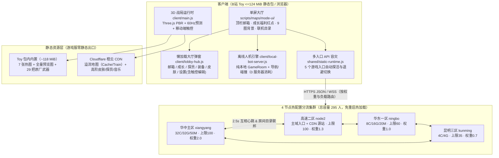

# 「随时随地CS」工程与运维全貌手册

> 本目录面向后续接手的开发、策划与运维同学，完整记录项目的 **系统设计、工程开发、集群运维、发版提审以及历史演进与避坑经验**。
>
> **安全红线**：本仓库为开源/托管代码仓库，文档中**严禁写入任何服务器真实 IP、root 密码、SSH 私钥、Cloudflare API Token 或玩家真实 UID**。真实主机清单与指纹仅保存在本地运维私密配置（`~/.ssh/config` 与运维运行手册）中。

---

## 一、项目速览

- **项目名称**：随时随地CS（基于 [ETO-ze/dust2-web](https://github.com/ETO-ze/dust2-web) `online-v1.4.0-perf.6.2` 深度二开）
- **核心形态**：无需安装的浏览器 / **B站 Toy**（ID：`60036873452544`）5v5 第一人称战术射击游戏，覆盖桌面端（键鼠）与移动端（横竖屏触控 + 2/3/4 指自定义键位）。
- **核心玩法与模式**：
  - **9 张经典地图**：`de_dust2`、`de_mirage`、`de_inferno`、`de_nuke`、`de_vertigo`、`de_anubis`、`de_ancient`、`de_cache`、`de_train`；
  - **在线实时联机**：竞技爆破（13 胜换边/加时）与团队死斗（100 击杀），支持公开大厅、一键快速加入、**自建 1v1 密码房**；
  - **纯本地离线「人机练习」**：客户端内嵌完整同源对局逻辑与 AI 寻路引擎，**断网/弱网可玩且零服务器消耗**，承担高峰期自然分流；
  - **成长、皮肤与系统邮箱**：216 款武器/匕首皮肤、10 位 CT/T 探员、13 套音乐盒、B站 Toy 关注与一键三连云端解锁、顶栏系统邮箱（支持公告与可扩展抽象奖励）。

---

## 二、全局架构总图

---

## 三、文档导航

| 文档 | 目标读者 | 核心内容 |
|---|---|---|
| **[DESIGN.md](DESIGN.md)** | 产品 / 前端 / 后端 / 美术 | 架构选型、大厅与战局 UI 设计、移动端适配、成长与红点联动、邮箱抽象奖励模型、1v1 密码房协议、离线人机引擎与 124 MiB 资源分层策略 |
| **[STORAGE-AND-MAIL.md](STORAGE-AND-MAIL.md)** | 产品 / 前端 / 运营 / 策划 | **B站 Toy 单玩家云存档 128 键 × 1024 B 官方硬上限与 v2 自动分片规划**、全量 5 层玩家存档盘点（含设置/键位/触控布局）、线上现存邮箱清单与玩家侧邮箱持久化方案 |
| **[DEVELOPMENT.md](DEVELOPMENT.md)** | 开发工程师 | 代码目录导览、本地启动与测试命令、核心工程约定与防坑规范、Vite + Toy 打包流程、预览自测与 B站提审 SOP |
| **[OPERATIONS.md](OPERATIONS.md)** | 运维 / 线上运营 | 4 节点拓扑与配额、免重启热配置调权/摘流、热发全服公告与定向皮肤/物品奖励、**零踢人蓝绿热更新 SOP**、TLS 证书自动续期、监控日志与急救手册 |
| **[HISTORY.md](HISTORY.md)** | 全体接手人 | 从 Fork 到 4 节点集群的完整演进时间线、关键技术路线取舍（含 WebRTC→WS 回切原因、香港节点断流复盘）以及 **14 个真实踩坑记录对照表** |

---

## 四、接手前必须牢记的 6 条红线

1. **绝不踢出在线玩家**：任何游戏服升级必须走 **Blue/Green 双槽位切换 + `SIGUSR2` 优雅排水**，确认目标空闲槽位 `humans === 0` 才重启。
2. **严禁影响同机共存服务**：部分节点与其他生产项目（Golden Hour、AimArena、Inkwave、FreeShip、GetJobs 等）共享宿主机，严禁修改其 nginx 站点、端口或 systemd 单元。
3. **禁止写死单一服务器入口**：节点上下线、上限、权重、CDN 域名必须通过 `/opt/cs2-web/cluster-config.json` 热更新，客户端静态包必须配置多入口容灾数组 `--game-origins=...`。
4. **Toy 包体严控 `<= 124 MiB`（平台硬限 128 MB）**：新增贴图/模型前必须确认分层策略（[scripts/build-toy-and-cdn.mjs](../../scripts/build-toy-and-cdn.mjs)），不要把重型高阶皮肤模型打进 Toy 主包。
5. **房间密码绝不进 URL、绝不进房间目录**：密码只能经 `sessionStorage` 传递并由 WebSocket `join` 包体提交，目录与快照仅返回布尔 `locked: true`。
6. **严守隐私与凭据隔离**：不在仓库、工单或公开输出中暴露服务器密码、API Token、真实 IP 或原始玩家 UID。
